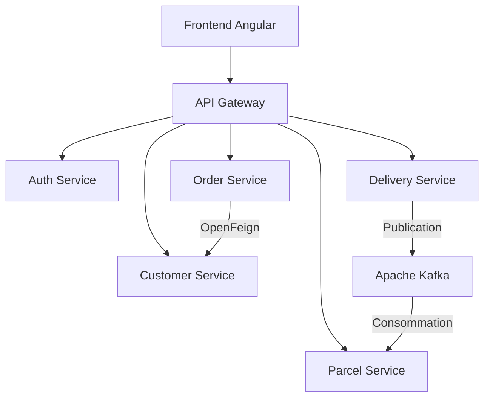
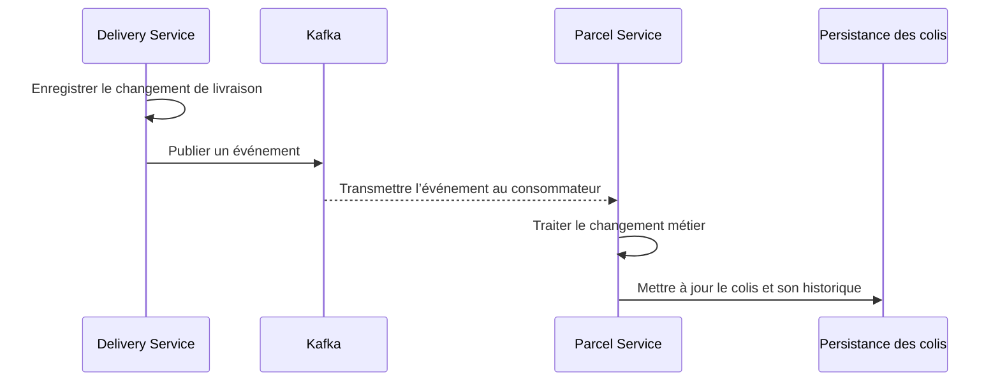

# SmartLog — Plateforme de gestion logistique

**Application web full-stack de gestion des clients, commandes, colis et livraisons, construite avec Spring Boot, Angular et Apache Kafka.**

SmartLog centralise les opérations logistiques et organise les échanges entre services métier. Le projet combine des API REST, une authentification JWT et des événements Kafka pour faire circuler les informations liées aux livraisons et au suivi des colis.

Développé dans le cadre d’un projet de stage chez **6SOLUTIONS**, il met en pratique une architecture microservices sur un cas d’usage logistique.

> **Périmètre de cette documentation :** ce README décrit les fonctionnalités et technologies connues du projet. Les noms de dossiers, versions exactes, ports, routes HTTP et paramètres d’infrastructure doivent être vérifiés dans le dépôt avant d’utiliser les instructions de lancement. Le suivi GPS, l’estimation de livraison et la détection des retards font partie des évolutions prévues.

## Sommaire

- [Contexte et objectifs](#contexte-et-objectifs)
- [Fonctionnalités](#fonctionnalités)
- [Architecture](#architecture)
- [Technologies](#technologies)
- [Services et responsabilités](#services-et-responsabilités)
- [Parcours métier](#parcours-métier)
- [Communication entre services](#communication-entre-services)
- [Installation et démarrage](#installation-et-démarrage)
- [Configuration](#configuration)
- [Vérification du fonctionnement](#vérification-du-fonctionnement)
- [Dépannage](#dépannage)
- [Évolutions prévues](#évolutions-prévues)
- [Auteur](#auteur)

## Contexte et objectifs

Une activité de livraison doit coordonner plusieurs informations : les coordonnées des clients, les adresses, les commandes, les colis et les affectations aux livreurs. La répartition de ces informations entre plusieurs outils rend le suivi plus difficile.

SmartLog rassemble ces opérations dans une application web et répartit les responsabilités dans des services métier distincts.

Les objectifs du projet sont de :

- Centraliser la gestion des clients et de leurs adresses.
- Organiser le cycle de vie des commandes.
- Suivre les colis et conserver leur historique de statuts.
- Gérer les livreurs, les affectations et l’exécution des livraisons.
- Propager les événements de livraison vers le service chargé des colis.
- Proposer une interface Angular pour accéder aux fonctions métier.

## Fonctionnalités

### Authentification

- Authentification reposant sur des jetons JWT.
- Utilisation de Spring Security côté backend.
- Interface d’authentification dans l’application Angular.

### Clients et adresses

- Gestion des clients.
- Gestion des adresses associées aux clients.
- Mise à disposition des informations client pour les autres services métier.

### Commandes

- Gestion des commandes.
- Cycle de vie comprenant les états `DRAFT`, `VALIDATED` et `ANNULLED`.
- Communication avec le service client via OpenFeign.

### Colis

- Gestion des colis.
- Suivi des statuts et de leur historique.
- Consommation d’événements Kafka provenant du service de livraison.

### Livraisons

- Gestion des agents de livraison et des affectations.
- Suivi de l’exécution avec les états `STARTED`, `COMPLETED` et `FAILED`.
- Publication d’événements métier via Kafka.

### Interface web

L’interface Angular utilise PrimeNG et comprend les écrans consacrés à l’authentification, aux clients, aux commandes, aux colis et aux livreurs.

## Architecture

L’application s’appuie sur une architecture microservices. Le frontend accède aux API via une passerelle. Eureka assure la découverte des services ; OpenFeign permet les appels synchrones entre services ; Kafka transporte les événements métier.



Eureka et PostgreSQL sont omis de ce diagramme pour privilégier la lisibilité des échanges métier. La répartition physique des bases de données dépend de la configuration du dépôt.

## Technologies

| Domaine | Technologies | Rôle |
| --- | --- | --- |
| Backend | Java, Spring Boot | Développement des services et API REST |
| Frontend | Angular, PrimeNG | Interfaces et composants web |
| Sécurité | Spring Security, JWT | Authentification et sécurisation des accès |
| Persistance | Spring Data JPA, Hibernate | Accès aux données et mapping objet-relationnel |
| Base de données | PostgreSQL | Stockage des données métier |
| Passerelle API | Spring Cloud Gateway, WebFlux | Routage des requêtes |
| Découverte | Eureka | Enregistrement et découverte des services |
| Appels synchrones | OpenFeign | Communication HTTP entre services |
| Événements | Apache Kafka | Communication asynchrone |
| Configuration | Spring Cloud Config Client | Chargement de configuration externalisée selon le profil |
| Supervision | Spring Boot Actuator | Informations techniques et santé selon les endpoints exposés |
| Outillage | Maven, Git, Docker | Build, versionnement et infrastructure locale |

Les versions de référence sont celles déclarées dans les fichiers `pom.xml` et `package.json` du projet.

## Services et responsabilités

Les noms ci-dessous désignent les responsabilités logiques ; ils ne constituent pas une arborescence vérifiée du dépôt.

| Composant | Responsabilité |
| --- | --- |
| Discovery Service | Héberger le registre Eureka |
| API Gateway | Centraliser le routage vers les services |
| Auth Service | Gérer l’authentification JWT |
| Customer Service | Gérer les clients et adresses |
| Order Service | Gérer les commandes et leurs statuts |
| Parcel Service | Gérer les colis et l’historique de leurs statuts |
| Delivery Service | Gérer les livreurs, affectations et événements de livraison |
| Frontend Angular | Présenter les fonctions métier aux utilisateurs |

## Parcours métier

Un parcours de démonstration peut suivre les étapes suivantes, selon les actions disponibles dans l’interface :

1. S’authentifier dans l’application.
2. Créer un client et renseigner une adresse.
3. Créer une commande et effectuer sa validation.
4. Créer ou consulter le colis concerné.
5. Préparer une affectation de livraison.
6. Démarrer la livraison, puis enregistrer son résultat.
7. Consulter le statut du colis et son historique après traitement de l’événement.

Ce parcours ne suppose pas qu’une validation de commande crée automatiquement un colis : les automatismes exacts sont définis dans le code métier.

## Communication entre services

### Échanges synchrones

OpenFeign permet à un service d’appeler l’API d’un autre service lorsqu’il a besoin d’une réponse immédiate. Le service de commandes l’utilise notamment pour récupérer des informations auprès du service client.

Eureka fournit le registre de services. La passerelle centralise l’entrée des requêtes, tandis que les clients Feign servent aux échanges internes.

### Échanges asynchrones

Le service de livraison publie des événements Kafka au moyen de `DeliveryEventProducer`. Le service de colis consomme ces événements pour traiter les changements liés à la livraison.



La mise à jour du colis est asynchrone : elle peut intervenir après la réponse de l’API de livraison. Le nom des topics, le schéma des événements, les groupes de consommateurs et les garanties de traitement doivent être consultés dans la configuration et le code.

## Installation et démarrage

### 1. Préparer l’environnement

Installer :

- Le JDK correspondant à la version Java déclarée dans les `pom.xml`.
- Maven, ou utiliser le wrapper Maven s’il est présent.
- Une version de Node.js compatible avec la version Angular du projet.
- npm.
- Docker pour l’infrastructure locale.
- Git.

Vérifier les outils disponibles :

```bash
java -version
mvn -version
node --version
npm --version
docker --version
git --version
```

### 2. Récupérer le code

Cloner le ou les dépôts backend et frontend depuis leurs URL réelles. Si les services sont répartis dans plusieurs dépôts, récupérer chaque composant nécessaire.

### 3. Démarrer l’infrastructure

Préparer PostgreSQL et Kafka avec les paramètres attendus par les services : bases, utilisateurs, mots de passe, adresses et ports.

Le projet utilise PostgreSQL dans Docker. La présence d’un déploiement Docker Compose complet n’est pas confirmée : cette documentation ne suppose donc pas qu’une commande unique démarre toute l’application.

### 4. Configurer les applications

Vérifier les fichiers de configuration et le profil Spring actif de chaque service. Les principaux points à renseigner sont détaillés dans la section [Configuration](#configuration).

Si le profil actif dépend d’un serveur Spring Cloud Config, rendre ce serveur disponible avant de lancer les applications clientes.

### 5. Démarrer le backend

Ordre de démarrage conseillé pour le développement local :

1. Infrastructure PostgreSQL et Kafka.
2. Serveur de configuration, si requis par le profil actif.
3. Discovery Service / Eureka.
4. Services métier et Auth Service.
5. API Gateway.

Dans le dossier Maven de chaque application Spring Boot, la commande standard est :

```bash
mvn spring-boot:run
```

Si le module fournit un wrapper Maven, il peut être utilisé à la place :

```bash
# Linux / macOS
./mvnw spring-boot:run
```

```powershell
# Windows PowerShell
.\mvnw.cmd spring-boot:run
```

Ces commandes sont à adapter si le dépôt utilise un projet Maven multi-module ou des profils spécifiques.

### 6. Démarrer le frontend

Dans le dossier contenant `package.json` :

```bash
npm install
```

Consulter les scripts disponibles :

```bash
npm run
```

Si un script `start` est défini :

```bash
npm run start
```

Vérifier que l’URL d’API configurée dans le frontend pointe vers l’API Gateway. Utiliser ensuite l’adresse affichée par le serveur de développement pour ouvrir l’application.

## Configuration

| Élément | Points à vérifier |
| --- | --- |
| Java et dépendances | Version du JDK et compatibilité Spring Boot / Spring Cloud |
| Ports HTTP | `server.port` de chaque application ; absence de conflits |
| PostgreSQL | URL JDBC, nom de base, utilisateur et mot de passe |
| JPA / Hibernate | Politique de création ou de mise à jour du schéma |
| Eureka | Adresse du registre et noms d’enregistrement des services |
| Gateway | Routes, prédicats et correspondance avec les services |
| JWT | Paramètres de signature, validation et expiration utilisés dans le code |
| Kafka | Bootstrap servers, topics, sérialisation et groupes de consommateurs |
| Config Client | Source de configuration, profil actif et disponibilité du serveur requis |
| Frontend | URL de l’API et configuration par environnement |
| CORS | Origine du frontend autorisée par la configuration backend |

Les identifiants de base de données et secrets de signature doivent être fournis par la configuration locale ou le mécanisme de secrets retenu, sans être publiés dans le dépôt.

## Vérification du fonctionnement

### Vérification technique

- Vérifier que les services attendus apparaissent dans Eureka.
- Contrôler la connexion à PostgreSQL dans les logs de chaque service concerné.
- Vérifier que la passerelle transmet les requêtes aux bons services.
- Vérifier l’authentification et l’envoi du JWT sur les requêtes protégées.
- Contrôler la connexion des producteurs et consommateurs à Kafka.
- Consulter les endpoints Actuator uniquement s’ils sont exposés et autorisés dans le profil actif.

### Vérification métier

Exécuter le parcours de démonstration décrit plus haut, puis vérifier la cohérence entre l’état de la livraison, l’état du colis et son historique.

### Tests et compilation

Pour exécuter les tests backend présents dans un module Maven :

```bash
mvn test
```

Pour compiler et exécuter les vérifications configurées dans le cycle Maven :

```bash
mvn verify
```

Côté frontend, utiliser les scripts de test et de build effectivement déclarés dans `package.json`.

Ces commandes ne constituent pas une affirmation de couverture de tests : le contenu des suites doit être vérifié dans le dépôt.

## Dépannage

| Symptôme | Vérifications utiles |
| --- | --- |
| Service absent d’Eureka | Disponibilité du registre, URL Eureka, nom du service et logs de démarrage |
| Erreur de routage via la Gateway | Prédicat de route, chemin appelé et service cible |
| Requête bloquée par CORS | Origine exacte du frontend et traitement des requêtes préliminaires `OPTIONS` |
| Réponse `401` ou `403` | Présence et validité du JWT, règles de sécurité et autorisations attendues |
| Échec de connexion PostgreSQL | Conteneur actif, base existante, port publié et identifiants |
| Informations client ou adresse absentes | Réponse du Customer Service, DTO et mapping côté consommateur Feign |
| `LazyInitializationException` | Chargement des relations JPA et transformation en DTO dans le périmètre transactionnel adapté |
| Bean `KafkaTemplate` introuvable | Dépendances Kafka, configuration du producteur et paramètres de création du bean |
| Colis non mis à jour après une livraison | Événement publié, topic, groupe de consommateurs, désérialisation et logs du consommateur |
| Erreur de configuration au démarrage | Profil Spring actif et disponibilité de la source de configuration |

## Évolutions prévues

Les éléments suivants représentent des pistes d’évolution et ne sont pas présentés comme des fonctionnalités déjà livrées :

- [ ] Tableau de bord de suivi de l’activité logistique.
- [ ] Service de notifications.
- [ ] Service de tracking pour la position des colis ou des livreurs.
- [ ] Estimation des délais de livraison.
- [ ] Détection des retards.
- [ ] Orchestration locale complète avec Docker Compose.
- [ ] Exploration d’un déploiement Kubernetes, selon les besoins du projet.

## Auteur

**Adam Zaghi** — Élève ingénieur en Informatique et Réseaux, EMSI Casablanca.

- GitHub : [adam-zaghi](https://github.com/adam-zaghi)
- LinkedIn : [Adam Zaghi](https://www.linkedin.com/in/adam-zaghi-515a5b242/)

Projet réalisé dans le cadre d’un stage chez **6SOLUTIONS**.
